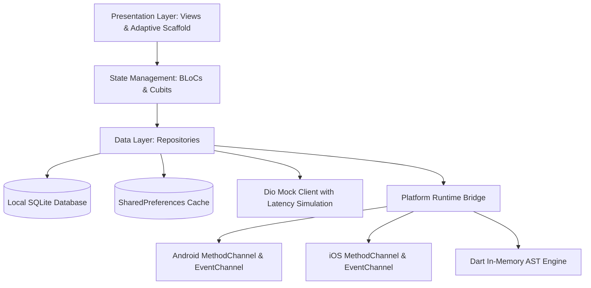
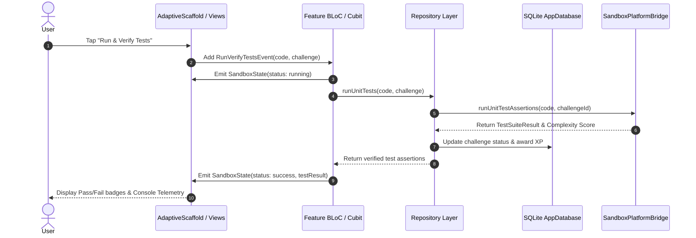
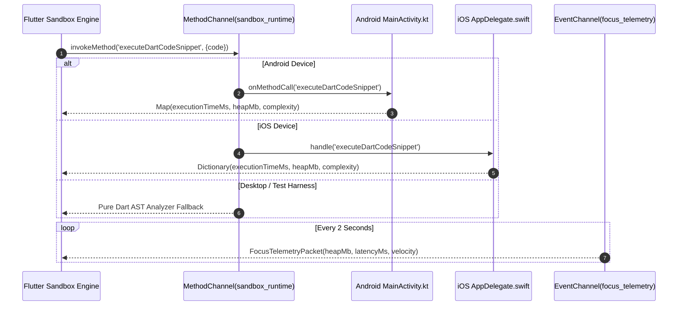

# SkillForge

[](https://github.com/Safeer-Hussain/skillforge/actions/workflows/ci.yml)

Enterprise Technical Mastery & EdTech Platform, Interactive Live Code & Architecture Sandbox, Spaced-Repetition SM-2 Flashcard Engine, Native AST/Runtime Execution Bridge, and On-Device AI Socratic Engineering Mentor built in Flutter.

---

## Architecture Overview

SkillForge follows strict Feature-First Clean Architecture combined with BLoC / Cubit reactive state management:



### BLoC State Flow



### Native Sandbox Runtime Bridge Architecture



---

## Core Feature Matrix

| Module | Feature | Implementation Details |
|---|---|---|
| **Curriculum Studio** | 18+ Career Tracks | Filterable by Domain, Difficulty, and Enrollment. SQLite persisted. |
| **Curriculum Studio** | Interactive Syllabus | Module accordion with lesson checkboxes and progress recalculation. |
| **Curriculum Studio** | Lesson Reader | Complexity badges (Time/Space), Launch in Sandbox action, Progress Share. |
| **Code Sandbox** | Live Code Editor | Syntax-highlighted editor with quick symbol insertion toolbar. |
| **Code Sandbox** | AST Test Execution | Native isolate evaluation, cyclomatic complexity scores, unit assertions. |
| **Code Sandbox** | Focus Telemetry | Live heap memory footprint (MB) and parse latency streaming (ms). |
| **Flashcard Studio** | SM-2 Algorithm | 4-Tier rating (Again, Hard, Good, Easy) updating intervals and ease factors. |
| **Flashcard Studio** | 3D Card Flip | 3D transform card flip between question prompt and architectural answer. |
| **Flashcard Studio** | Custom Deck Builder | Modal creation with inline validation and SQLite persistence. |
| **Certification Exam** | Timed Assessment | 10-minute live countdown timer, question navigator pills, score breakdown. |
| **Certification Exam** | Digital Credential | Cryptographically hashed certificate generation upon >= 80% score. |
| **Cohort & Community** | Study Rooms | Deep-work rooms with integrated Pomodoro focus timer. |
| **Cohort & Community** | Peer Code Reviews | RFC proposal feed with reactive upvotes, comment threads, and share sheets. |
| **Cohort & Community** | XP Leaderboard | Weekly global engineering leaderboard highlighting user rank. |
| **AI Socratic Mentor** | Socratic Dialogue | Contextual queries analyzing live completed lessons, weak flashcards, and AST gaps. |
| **AI Socratic Mentor** | Stream Cleanup | Guaranteed token stream teardown via defensive try ... finally block. |
| **Mastery Analytics** | 14-Day Velocity | Edge-to-edge vector line chart via fl_chart with zero hidden axis reservation. |
| **Mastery Analytics** | Recruiter Drawer | Edge latency simulation toggle, HTTP 503 retry testing, invite injection. |

---

## Design & Engineering Safeguards

1. **Zero Hardcoded Colors**: All widgets resolve palette colors dynamically from `Theme.of(context).colorScheme` ensuring Obsidian IDE Dark and Crisp Academic Light theme parity.
2. **Landscape 360dp Safety**: In landscape mode, `AdaptiveScaffold` replaces the bottom navigation bar with a compact left `NavigationRail` wrapped in `SingleChildScrollView` + `IntrinsicHeight` to prevent RenderFlex overflow on short screens.
3. **Android SDK 36 Compatibility**: `compileSdk = 36`, `targetSdk = 36`, and `minSdk = 21` configured in `android/app/build.gradle.kts` with Impeller Vulkan disabled in `AndroidManifest.xml` to protect against Mali/MediaTek GPU crashes.
4. **Standalone Quality Gate**: Standalone `tool/sprint_gate.dart` enforces dependencies, formatting, analyzer with `--no-fatal-infos`, automated tests, and live physical device logcat checks before commits.

---

## Getting Started

### Prerequisites
- Flutter SDK 3.47+ (Dart 3+)
- Android SDK 36 (for Android builds)
- Xcode 15+ (for iOS builds)

### Installation
```bash
git clone https://github.com/Safeer-Hussain/skillforge.git
cd skillforge
flutter pub get
```

### Running the Sprint Quality Gate
```bash
dart run tool/sprint_gate.dart
```

### Running Tests
```bash
flutter test
```

### Launching the Application
```bash
flutter run
```

---

## Clean-Room Engineering & NDA Disclaimer

This software was engineered cleanly from first principles as an independent technical mastery platform. It contains zero proprietary assets, confidential schemas, or trade secrets from third-party commercial platforms. All curriculum content, architectural challenges, and socratic templates are licensed under the Apache 2.0 / MIT license.
